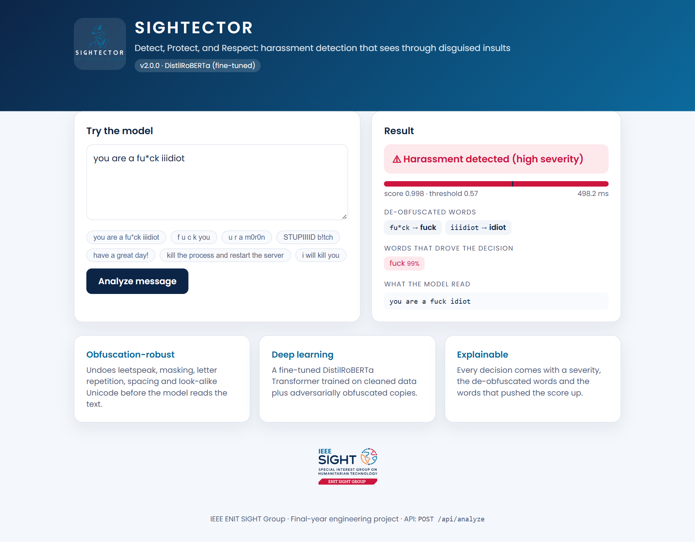
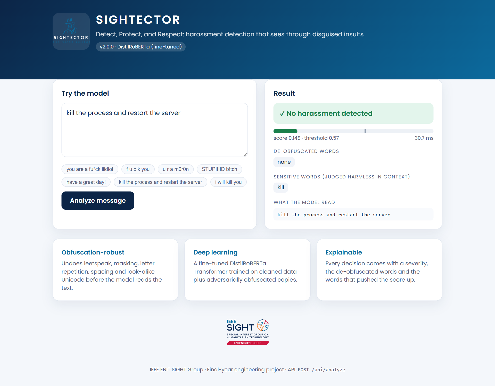
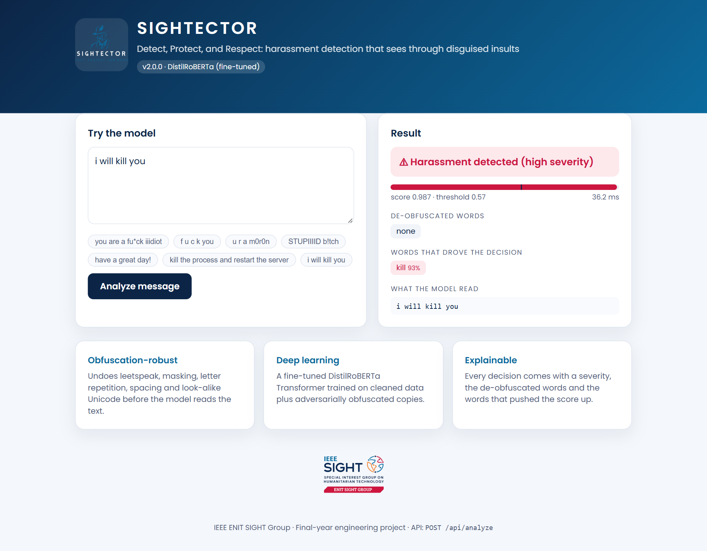
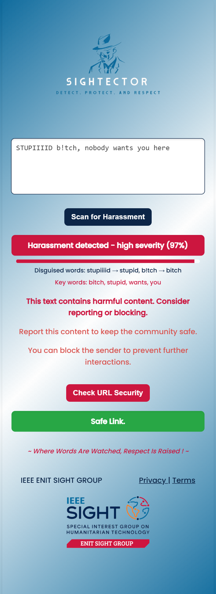
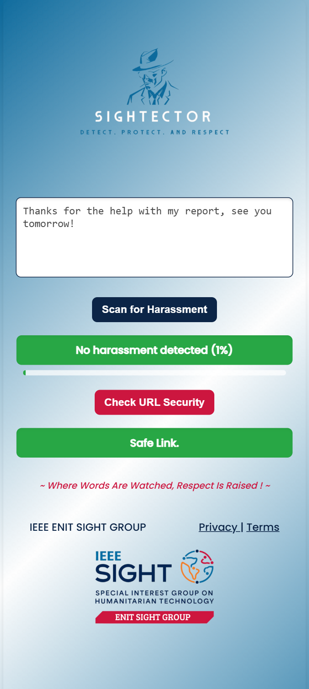
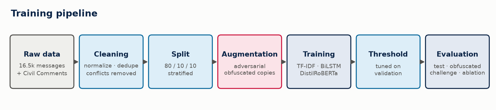

<div align="center">


# Sightector

**Detect, Protect, and Respect: online harassment detection that sees through disguised insults**

A browser extension and REST API powered by a fine-tuned **DistilRoBERTa** Transformer,
an obfuscation-aware text normalizer and explainable predictions.

*Final-year engineering project · IEEE ENIT SIGHT Group*

</div>

---

## Why v2?

People who harass online disguise their words to get past filters: `fu*ck`, `iiidiot`, `f u c k`,
`1d10t`, `sh!t`, `ѕtupid` (with a Cyrillic `ѕ`). Version 1 of Sightector missed most of them, and
an audit found three root causes:

| # | Problem in v1 | Consequence | Fix in v2 |
|---|---|---|---|
| 1 | The server called `vectorizer.fit_transform([text])`, **re-fitting TF-IDF on each message** | the IDF weights learned in training were thrown away at prediction time | a single trained pipeline, used as-is at inference |
| 2 | The notebook ran `pd.concat([df, df])` **before** `train_test_split` | ~80 % of test rows were also in training (**data leakage**), so the reported 97 % accuracy was inflated | dedupe *after* normalization, stratified 80/10/10 split |
| 3 | Word-level features + a 1 081-word stop-list (which deleted words like `bad` and `maro`) | every disguised word became an unknown token | obfuscation-aware normalizer + sub-word Transformer + adversarial augmentation |

## Results

All numbers are measured on data **never seen during training or model selection**.
Macro-F1 is the main metric because the classes are unbalanced (57 % harassment).

| Evaluation set | Legacy v1 | TF-IDF + LogReg | BiLSTM + Attention | **DistilRoBERTa** |
|---|:-:|:-:|:-:|:-:|
| Test set (2 584 messages) | 0.832 | 0.893 | 0.892 | **0.924** |
| Obfuscated test set | 0.707 | 0.887 | 0.880 | **0.912** |
| Hand-written challenge set (78) | 0.625 | 0.889 | 0.905 | **0.908** |
| *Obfuscated insults (challenge)* | *27 % acc.* | *100 %* | *100 %* | *91 %* |

DistilRoBERTa on the test set: **accuracy 92.6 %, precision 93.7 %, recall 93.5 %, ROC-AUC 0.972**.
The full tables are in [artifacts/reports/benchmark.md](artifacts/reports/benchmark.md), and the
analysis is in the [project report](docs/REPORT.md).

<p align="center"></p>

## Screenshots

| Disguised insult (`fu*ck iiidiot`) | Harmless use of a violent word |
|---|---|
|  |  |

| Spaced letters + leetspeak | Threat |
|---|---|
|  |  |

| Browser extension: harassment | Browser extension: clean |
|---|---|
|  |  |

## Architecture




The project follows a layered architecture. Each layer depends only on the layers below it, and every model
implements the same small `TextClassifier` interface (`predict_proba`, `save`), so models can be swapped
without touching the API.

```
sightector/                       core ML package (python -m sightector ...)
├── config.py                     every path & hyper-parameter
├── text/                         TEXT LAYER
│   ├── lexicon.py                offensive-term lexicon + spelling variants
│   ├── normalizer.py             de-obfuscation (leet, masks, spacing, homoglyphs, elongation)
│   └── obfuscation.py            adversarial obfuscation generator (augmentation + robustness test)
├── data/                         DATA LAYER
│   ├── prepare.py                clean → dedupe → split → augment
│   └── external.py               Civil Comments enrichment (threats, identity attacks, hard negatives)
├── models/                       MODEL LAYER (common TextClassifier interface)
│   ├── baseline.py               TF-IDF word + char n-grams + Logistic Regression
│   ├── bilstm.py                 BiLSTM + additive attention (from scratch, PyTorch)
│   └── transformer.py            fine-tuned DistilRoBERTa (Hugging Face)
├── training/                     TRAINING LAYER
│   ├── trainer.py                generic loop: AdamW, warm-up, fp16, clipping, early stopping
│   └── train.py                  per-model entry points + threshold tuning
├── evaluation/                   EVALUATION LAYER
│   ├── metrics.py                metrics + threshold search
│   ├── evaluate.py               benchmark, ablation, error analysis
│   └── plots.py                  report figures
├── inference/predictor.py        INFERENCE LAYER: HarassmentDetector (normalize → score → explain)
└── resources/offensive_lexicon.txt
server/                           Flask REST API + dashboard (app factory, blueprints)
extension/                        Chrome/Edge extension (Manifest V3)
tests/                            pytest: normalizer + API (fake model, runs in < 1 s)
scripts/                          screenshots, diagrams, presentation builder
data/                             raw dataset, challenge set, processed splits
artifacts/                        trained models + evaluation reports
docs/                             report, slides, figures, screenshots
legacy/                           v1 code, notebook and models (kept for comparison)
```

## Quick start

### 1. Install

```bash
python -m venv venv
venv\Scripts\activate            # Windows   (Linux/macOS: source venv/bin/activate)
pip install -r requirements.txt  # PyTorch with CUDA 12.4; a CPU-only machine works too
```

### 2. Get the models

The TF-IDF baseline ships with the repository, so the server works straight after cloning.
For the full deep-learning model, train it (about 7 minutes on an RTX 4060 laptop GPU):

```bash
python -m sightector download-external   # Civil Comments enrichment, ~190 MB, once
python -m sightector prepare             # clean, split and augment
python -m sightector train all           # baseline + BiLSTM + DistilRoBERTa
python -m sightector evaluate            # benchmark tables + figures
```

The server picks the best model it finds: `transformer` → `bilstm` → `baseline`.
To force one, set `SIGHTECTOR_MODEL=baseline`.

### 3. Run the API and dashboard

```bash
python -m server                         # http://127.0.0.1:5000
```

Open <http://127.0.0.1:5000> for the live demo. A link such as `/?q=you+are+an+iiidiot` analyzes
its text immediately.

### Or run it with Docker

```bash
docker build -t sightector:2.0.0 .        # or: docker compose up --build
docker run -p 5000:5000 sightector:2.0.0  # http://127.0.0.1:5000
```

The image runs CPU inference behind Waitress and bundles whatever models are in `artifacts/models/`
at build time. Train the Transformer first to ship it; otherwise the image serves the baseline.
Choose the model with `-e SIGHTECTOR_MODEL=bilstm`.

### 4. Load the browser extension

1. Open `chrome://extensions` (or `edge://extensions`) and enable **Developer mode**.
2. Click **Load unpacked** and select the [extension/](extension/) folder.
3. Select some text on any page, click the Sightector icon, then **Scan for Harassment**.

### 5. Run the tests

```bash
pytest -q
```

## API

`POST /api/analyze`

```json
{ "text": "you are a fu*ck iiidiot" }
```

```json
{
  "harassment": true,
  "score": 0.9978,
  "severity": "high",
  "threshold": 0.57,
  "model": "DistilRoBERTa (fine-tuned)",
  "normalized_text": "you are a fuck idiot",
  "offensive_terms": ["fuck", "idiot"],
  "deobfuscated": [
    { "original": "fu*ck", "normalized": "fuck" },
    { "original": "iiidiot", "normalized": "idiot" }
  ],
  "highlights": [{ "word": "fuck", "importance": 0.991 }],
  "latency_ms": 38.2
}
```

| Endpoint | Purpose |
|---|---|
| `GET /api/health` | model name, kind, threshold, version |
| `POST /api/analyze` | full explained analysis of one message (≤ 20 000 chars) |
| `POST /api/analyze/batch` | `{"texts": [...]}`, up to 100 messages, no explanations |
| `POST /` | v1-compatible response `{"harassment": bool, "score", "severity"}` |

**How to read the result:**
- `severity` is `none` below the tuned threshold, `high` from a score of 0.90 and `medium` in between.
- `highlights` comes from **word occlusion**: each word is removed in turn, and the drop in log-odds is
  reported as that word's share of the decision.
- Texts longer than 120 words are scored in overlapping windows, and the most harassing window decides,
  so one insult cannot be diluted by a long page.

## How the obfuscation handling works

1. **Unicode folding**: NFKC, accents and look-alike letters from Cyrillic and Greek (`ѕtupid` → `stupid`,
   `𝐟𝐮𝐜𝐤` → `fuck`).
2. **Spaced letters**: `f u c k` and `F.U.C.K` → `fuck`.
3. **Token repair**: leetspeak (`1d10t`), masks (`f**k`, `b*tch`), inserted symbols (`fu*ck`) and
   elongation (`iiidiot`, `fuuuuck`).
4. **Split words**: `fuck  ing` → `fucking` and `ass hole` → `asshole`.
5. **Abbreviations**: `stfu`, `kys`, `wtf` and similar.

Every repair is **validated against a lexicon** of 145 offensive terms and 46 spelling variants, so normal text is never
rewritten: `4you`, `class`, `as`, `kill the process` and `I have 3 cats` all stay unchanged. The
lexicon only guides normalization and explanations. The **decision is always made by the neural model**,
which is why "kill the process" is judged harmless while "i will kill you" is flagged.

## Limitations

- Implicit threats with no violent words ("i know where you live") and stereotype-based sexism
  ("women belong in the kitchen") are still missed sometimes. They need more data of that kind.
- The original dataset contains label noise: 17 of the 31 most confident "false positives" contain
  explicit insults but are labelled *clean* in the source data.
- The language is English, plus some Hinglish found in the original dataset.

See the [report](docs/REPORT.md) for the full analysis and future work.

## Documentation

- [Project report](docs/REPORT.md) ([PDF](docs/REPORT.pdf)): problem, data, methods, experiments, results,
  ablation, error analysis.
- [Presentation slides](docs/Sightector_Presentation.pptx): 16 slides with speaker notes.
- Evaluation outputs: [artifacts/reports/](artifacts/reports/)

Every document can be regenerated after re-training:

```bash
pip install -r requirements-dev.txt
python -m sightector evaluate             # tables + figures
python scripts/make_diagrams.py           # architecture / pipeline diagrams
python -m server &                        # then, in another terminal:
python scripts/make_screenshots.py        # dashboard + extension screenshots
python scripts/build_report_pdf.py        # docs/REPORT.pdf
cd scripts && npm install && npm run slides   # docs/Sightector_Presentation.pptx
```

## Credits

Built by the IEEE ENIT SIGHT Group (École Nationale d'Ingénieurs de Tunis).
Enrichment data: [Civil Comments](https://huggingface.co/datasets/google/civil_comments) (Jigsaw, CC0).
Base model: [distilroberta-base](https://huggingface.co/distilroberta-base).

## License

This project is released under the MIT License. See [LICENSE](LICENSE).
