# Sightector v2: Obfuscation-Robust Online Harassment Detection with Deep Learning

**Final-year engineering project report** · IEEE ENIT SIGHT Group · École Nationale d'Ingénieurs de Tunis

---

## Abstract

Sightector is a browser extension that warns users when a message they read contains harassment. Its first
version used a word-level TF-IDF + LinearSVC classifier. It reported 97 % accuracy, yet in practice it failed on
simple disguises such as `fu*ck` or `iiidiot`. This report explains why. The serving code re-fitted the vectorizer
on every message, and the notebook leaked test data into training. We then rebuilt the system end-to-end.

The new system has five parts:

- an **obfuscation-aware normalizer** that undoes leetspeak, masking, spacing, elongation and look-alike Unicode;
- a training set **cleaned, de-duplicated and enriched** with 9 449 annotated comments from Civil Comments, which
  adds threats, identity attacks and "hard negatives";
- **adversarial data augmentation**;
- three models compared under identical conditions: a TF-IDF baseline, a BiLSTM with attention and a fine-tuned
  **DistilRoBERTa** Transformer;
- an explainable REST API used by the extension.

On a held-out test set of 2 584 messages, DistilRoBERTa reaches **0.924 macro-F1** (accuracy 92.6 %, ROC-AUC 0.972).
On an adversarially obfuscated copy of that test set it reaches **0.912 macro-F1**, against 0.707 for v1. On an
independent hand-written challenge set it reaches **0.908**, against 0.625 for v1.

---

## Table of contents

1. [Introduction](#1-introduction)
2. [Audit of the first version](#2-audit-of-the-first-version)
3. [Data](#3-data)
4. [Methods](#4-methods)
5. [Experimental setup](#5-experimental-setup)
6. [Results](#6-results)
7. [Ablation study](#7-ablation-study)
8. [Error analysis](#8-error-analysis)
9. [System design and implementation](#9-system-design-and-implementation)
10. [Limitations and ethical considerations](#10-limitations-and-ethical-considerations)
11. [Future work](#11-future-work)
12. [Conclusion](#12-conclusion)
13. [Appendix: reproducing the results](#appendix-reproducing-the-results)

---

## 1. Introduction

### 1.1 Context

Online harassment (insults, threats, sexist and identity-based attacks) affects a large share of internet users,
and the people targeted often face it alone. Platforms moderate content, but only after the fact. Sightector takes
the user's side instead. The user selects any text on any web page, and the extension says whether that text is
harassment, how severe it is and why.

### 1.2 Problem statement

People who harass deliberately bypass keyword filters by **obfuscating** their words:

| Technique | Example | What a word-level model sees |
|---|---|---|
| Masking | `f**k`, `b*tch` | unknown tokens |
| Inserted symbols | `fu*ck`, `f-u-c-k` | unknown tokens |
| Leetspeak | `1d10t`, `sh!t`, `a$$hole` | unknown tokens |
| Letter elongation | `iiidiot`, `stuuupid` | unknown tokens |
| Spacing | `f u c k you` | four one-letter "words" |
| Homoglyphs | `ѕtupid` (Cyrillic `ѕ`) | an unknown token |
| Split words | `fuck  ing` | two words |

The client observed that v1 "does not read harassment clearly" when words are written this way.

### 1.3 Objectives

1. Find out why v1 fails.
2. Clean the dataset and build a leakage-free evaluation.
3. Make detection robust to obfuscation.
4. Train and compare deep-learning models against a strong classical baseline.
5. Deliver an explainable, tested API and an upgraded extension.

---

## 2. Audit of the first version

Reading the v1 code ([legacy/DetectionModelServer](../legacy/DetectionModelServer)) revealed three defects. Each one
alone explains part of the bad behaviour seen in production.

**Defect 1: the vectorizer was re-fitted at inference.** The server built a new `TfidfVectorizer` with the training
vocabulary and then called `fit_transform([user_input])`. Fitting on one document recomputes the inverse document
frequency (IDF) from that document alone, so every word gets the same IDF. The term weighting the classifier was
trained on is lost, and the model receives a distorted input vector.

**Defect 2: train/test leakage.** The notebook ran `combined_df = pd.concat([df, df])` and only then
`train_test_split`. Every message existed twice, so about 80 % of test messages had an identical copy in the
training set. The reported 95–97 % accuracy therefore measured memorization rather than generalization.

**Defect 3: features that discard the signal.**
- The custom stop-list (1 081 words) deleted words such as `bad` and `maro` (Hindi for "hit").
- Preprocessing kept only `[a-zA-Z#]` characters, so `f**k` became `f k`.
- A word-level vocabulary has no representation for `iiidiot`.

We re-ran the legacy system exactly as it was served, with the IDF re-fit included, on our new evaluation sets.
It reaches only **0.707 macro-F1 on obfuscated text** and **0.625 on the challenge set**. On obfuscated insults it
is correct only 27 % of the time (§6).

---

## 3. Data

### 3.1 Sources

| Source | Messages | Harassment | Content |
|---|---:|---:|---|
| Original Sightector dataset | 16 471 | 60.6 % | Wikipedia talk-page comments (Jigsaw-style), tweets, some Hinglish |
| Civil Comments (Jigsaw, CC0), sampled | 9 500 (9 449 after cleaning) | 52.4 % | news-site comments with crowd-sourced toxicity sub-labels |

**Why enrich the data?** The first models we trained on the original data alone missed "i will kill you", "go kill
yourself" and "i know where you live and i will hurt you". The original data is dominated by profane insults and
contains very few threats. We therefore sampled from Civil Comments, using the rule "at least half of the
annotators agreed" (score ≥ 0.5). The sample contains:

- 2 000 threats, 1 500 identity attacks, 1 000 sexually explicit comments and 500 insults;
- 2 500 **hard negatives**: clean comments (toxicity < 0.1) that contain words such as *kill, die, shoot, hate,
  stupid*, so the model learns context instead of keywords;
- 2 000 random clean comments.

### 3.2 Cleaning

| Step | Rows |
|---|---:|
| Raw rows (original + enrichment) | 25 947 |
| Messages that normalize to empty | 0 removed |
| Texts that appear with **contradicting labels** | 3 removed |
| **Duplicates after normalization** | 106 removed |
| **Clean dataset** | **25 833** (14 866 harassment / 10 967 clean) |

Duplicates are detected **after normalization**, so `F*CK YOU` and `fuck you` count as the same message and can
never end up on both sides of the train/test split.

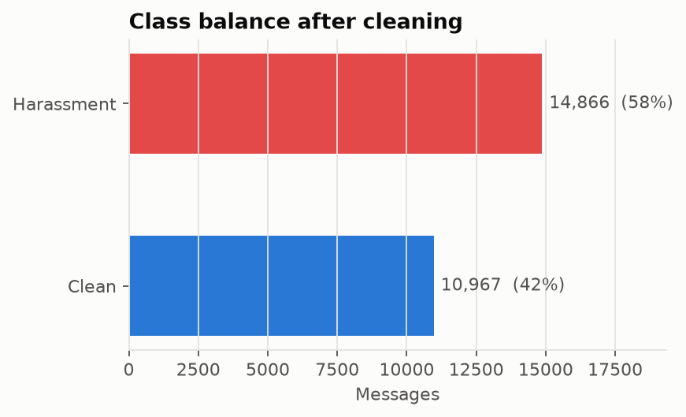

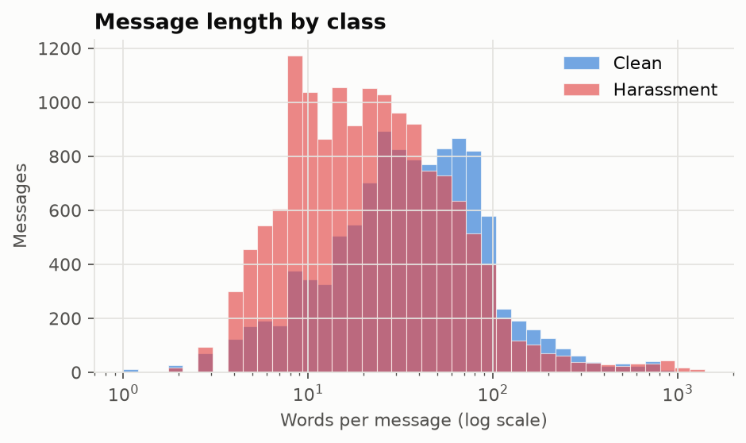

Harassment messages are shorter (median 21 words) than clean ones (median 36 words). Lengths range from one
word to several thousand. This motivates the sliding-window inference described in §4.6.

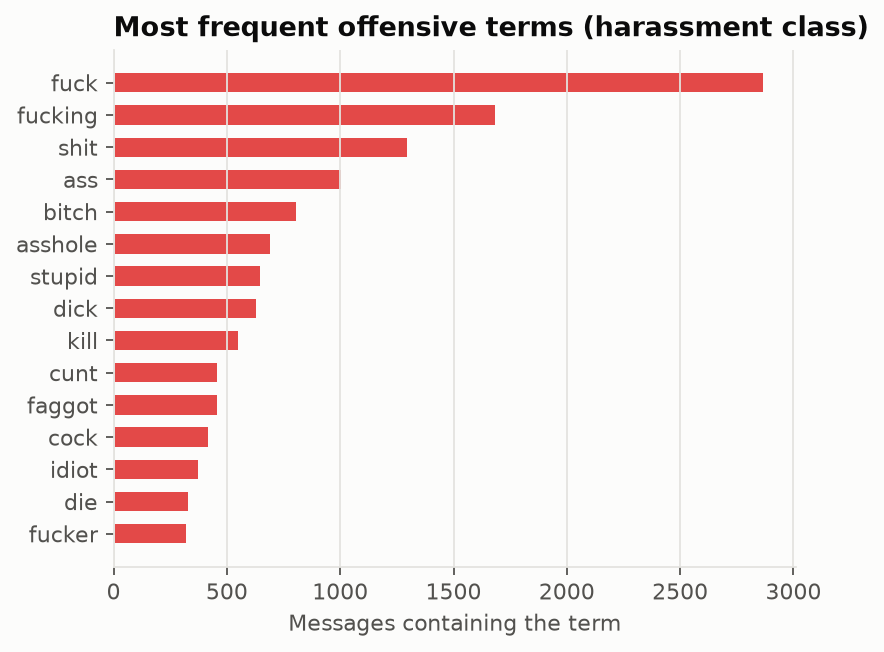

### 3.3 Split

The data was split 80 / 10 / 10 into train, validation and test, **stratified by source × label** so every split has
the same mix: 20 666 / 2 583 / 2 584 messages. The validation set is used for early stopping and threshold tuning.
The test set is used once, for the final numbers.

### 3.4 Evaluation sets

| Set | Size | Purpose |
|---|---:|---|
| `test` | 2 584 | standard held-out performance |
| `test_original` | 1 639 | test rows from the original dataset only |
| `test_obfuscated` | 2 584 | the test set with **every** offensive word disguised and 10 % of other words noised (different random seed from training) |
| `challenge` | 78 | **hand-written**, independent of every dataset: obfuscated insults, threats, sexism, Hinglish, and *tricky clean* sentences such as "kill the process and restart the server" |

### 3.5 Adversarial data augmentation

For every harassment training message that contains an offensive term, we add one copy in which those terms are
disguised. Each disguise is drawn at random from leetspeak, masking, symbol insertion, elongation, spacing,
homoglyphs and random capitals.

**Clean messages are augmented too.** Half of them get a noisy copy in which offensive-looking and ordinary words
are disguised. Without this, the model could learn the shortcut "strange spelling = harassment". After augmentation
the training set contains 33 314 messages.

---

## 4. Methods

### 4.1 Obfuscation-aware normalization

The normalizer ([sightector/text/normalizer.py](../sightector/text/normalizer.py)) runs **identically during
training and inference**, so the model always sees the same input distribution.

1. **Unicode folding**: HTML unescape, removal of zero-width characters, NFKC (`𝐟𝐮𝐜𝐤` → `fuck`), lower-casing,
   accent stripping and a homoglyph table (Cyrillic `а е о р с у х і ѕ` and Greek letters → Latin).
2. **URLs and mentions** are replaced by `url` and `@user`.
3. **Spaced letters**: a run of three or more single characters separated by spaces or punctuation is joined
   (`f u c k`, `F.U.C.K`) if the result is an offensive term.
4. **Token repair**. For each token containing a leet character, a mask character or a doubled letter:
   - the normalizer generates candidates by substituting leet characters (`1 → i/l`, `0 → o`, `@ → a`, `$ → s`, `! → i/l` …);
   - for each candidate it tries **removing** mask characters (`fu*ck` → `fuck`) and treating them as **wildcards**
     (`f**k` → `f..k` → `fuck`);
   - it compares candidates after collapsing repeated letters (`iiidiot` → `idiot`).
5. **Split words**: `fuck ing` → `fucking`, `ass hole` → `asshole`.
6. **Variants and abbreviations**: `stfu`, `kys`, `wtf`, `fck`, `biatch` …

**Safety property.** A repair is applied only if the result is in the offensive lexicon (145 terms + 46 variants).
Ordinary text is therefore never altered: `4you`, `class`, `as`, `kill the process` and `I have 3 cats` stay as
they are. Fourteen de-obfuscation cases and five "must not change" cases are covered by unit tests.

### 4.2 Model 1: TF-IDF + Logistic Regression (baseline)

The features are a union of word 1–2-gram and **character 2–5-gram** TF-IDF vectors, with sublinear TF and up to
200 000 features each. The classifier is L2-regularized logistic regression (C = 4, class-balanced). Character
n-grams give the baseline partial robustness to spelling noise.

### 4.3 Model 2: BiLSTM with additive attention (from scratch)

Each token $x_t$ is embedded (200-d, learned from scratch). A bidirectional LSTM produces
$h_t = [\overrightarrow{h_t}; \overleftarrow{h_t}] \in \mathbb{R}^{256}$. Additive attention then computes

$$e_t = v^\top \tanh(W h_t + b), \qquad \alpha_t = \frac{e^{e_t}}{\sum_k e^{e_k}}, \qquad c = \sum_t \alpha_t h_t .$$

The classifier input is the concatenation of the attention context $c$ and a max-pool over $h_t$, followed by
dropout (0.4) and a linear layer. The model has 7.2 M parameters, mostly the 34 021-word embedding table.

### 4.4 Model 3: fine-tuned DistilRoBERTa (deployed model)

DistilRoBERTa is a 6-layer, 82 M-parameter Transformer distilled from RoBERTa-base. It was pre-trained on 160 GB of
English text. Each layer applies multi-head self-attention:

$$\text{Attention}(Q,K,V) = \text{softmax}\!\left(\frac{QK^\top}{\sqrt{d_k}}\right)V,$$

so every word's representation depends on the whole sentence. This is what lets the model tell
"*kill* the process" (harmless) from "I will *kill* you" (a threat).

Its **byte-level BPE** tokenizer never produces unknown tokens, so obfuscation that survives normalization still
reaches the model as meaningful sub-word pieces. We add a linear head on the `<s>` token that outputs one logit,
and we fine-tune the whole network.

### 4.5 Training procedure

Both neural models share one training loop ([sightector/training/trainer.py](../sightector/training/trainer.py)):

- **Loss**: binary cross-entropy on the logit, $\mathcal{L} = -[y\log\sigma(z) + (1-y)\log(1-\sigma(z))]$.
- **Optimizer**: AdamW. The Transformer uses lr 3e-5, weight decay 0.01 (no decay on biases or LayerNorm), 10 %
  linear warm-up and then linear decay. The BiLSTM uses lr 2e-3.
- **Mixed precision** (fp16 autocast + gradient scaling) and gradient clipping at 1.0.
- **Early stopping** on validation macro-F1 (patience 2), restoring the best weights.
- **Decision-threshold tuning**: the threshold maximizing validation macro-F1 is searched over [0.05, 0.95]. It is
  0.57 for DistilRoBERTa.

### 4.6 Inference and explainability

The inference service ([sightector/inference/predictor.py](../sightector/inference/predictor.py)) proceeds as follows:

1. normalize the text and record each repair (`fu*ck → fuck`);
2. score it; texts longer than 120 words are split into overlapping windows of 120 words (stride 60) and the
   **maximum** window score is used, so one insult in a long page is not diluted;
3. assign a severity: `none` below the threshold, `high` from 0.90, `medium` in between;
4. explain the decision by **occlusion in log-odds space**. Each word is removed in turn and the drop in
   $\log\frac{p}{1-p}$ is measured; the positive drops are normalized to sum to 1.

Log-odds are used because a probability saturates near 1: removing one of two insults moves $p$ from 0.998 to
0.995 but moves the logit clearly. For example, "STUPIIIID b!tch, nobody wants you here" yields
*bitch 42 %, stupid 29 %*.

---

## 5. Experimental setup

| Item | Value |
|---|---|
| Hardware | NVIDIA RTX 4060 Laptop GPU (8 GB), Windows 11 |
| Software | Python 3.12, PyTorch 2.6 (CUDA 12.4), Transformers 4.57, scikit-learn 1.9 |
| Seed | 42 for all splits and models |
| Max sequence length | 160 tokens |
| Batch size | 32 (Transformer), 64 (BiLSTM) |
| Training time | baseline 25 s · BiLSTM 49 s · DistilRoBERTa 7 min |
| Inference latency (DistilRoBERTa, one message) | 11 ms GPU · 18 ms CPU (37 ms CPU with explanation) |

**Metrics.** We report accuracy, precision, recall and F1 for the harassment class, plus **macro-F1** (the mean of
the per-class F1 scores, robust to the 57/43 class imbalance) and threshold-free ROC-AUC and PR-AUC.

---

## 6. Results

### 6.1 Main comparison (macro-F1)

| Evaluation set | Legacy v1 | TF-IDF + LogReg | BiLSTM + Attn | **DistilRoBERTa** |
|---|:-:|:-:|:-:|:-:|
| Test | 0.832 | 0.893 | 0.892 | **0.924** |
| Test (original data only) | 0.964\* | 0.920 | 0.926 | **0.937** |
| Obfuscated test | 0.707 | 0.887 | 0.880 | **0.912** |
| Challenge (hand-written) | 0.625 | 0.889 | 0.905 | **0.908** |

\* *Inflated, not comparable: v1 was trained on the whole original dataset, so these "test" rows were in its
training data. On every set it had not seen, v1 is the weakest system by a wide margin.*

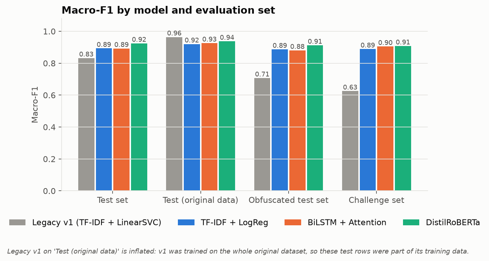

### 6.2 Detailed test-set metrics

| Model | Accuracy | Precision | Recall | F1 | ROC-AUC | PR-AUC |
|---|---|---|---|---|---|---|
| TF-IDF + LogReg | 0.896 | 0.904 | 0.916 | 0.910 | 0.959 | 0.971 |
| BiLSTM + Attention | 0.895 | 0.906 | 0.911 | 0.909 | 0.952 | 0.963 |
| **DistilRoBERTa** | **0.926** | **0.937** | **0.935** | **0.936** | **0.972** | **0.978** |

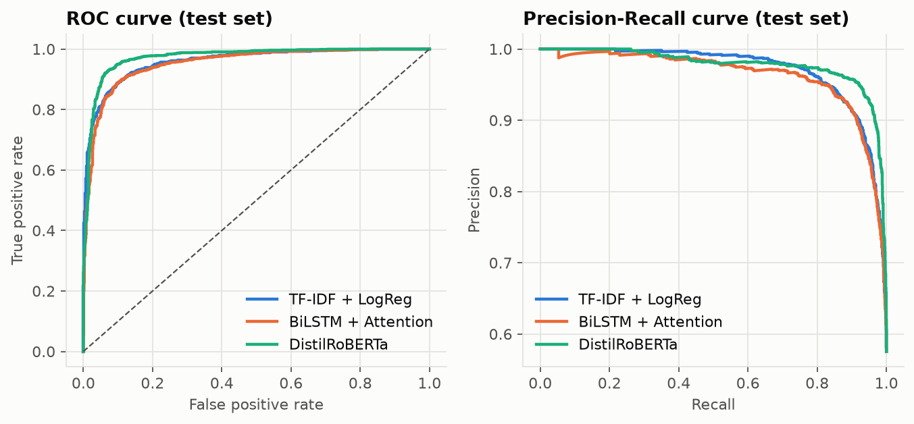

DistilRoBERTa's curves dominate at almost every operating point. At equal recall it produces fewer false alarms,
which matters for a tool that must not cry wolf.

<p align="center">
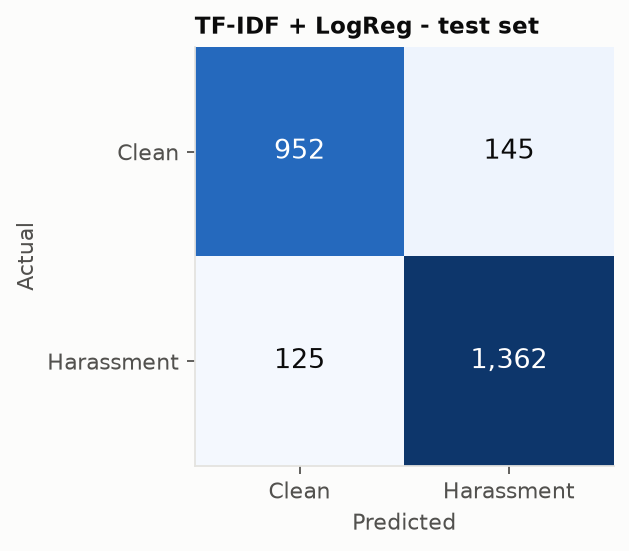
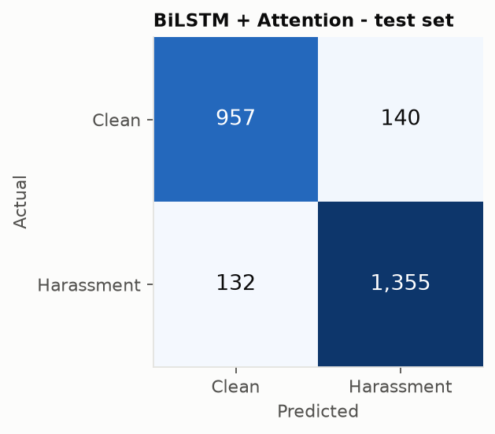
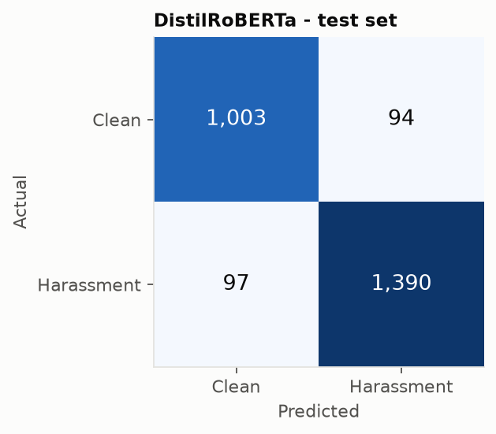
</p>

### 6.3 Learning curves

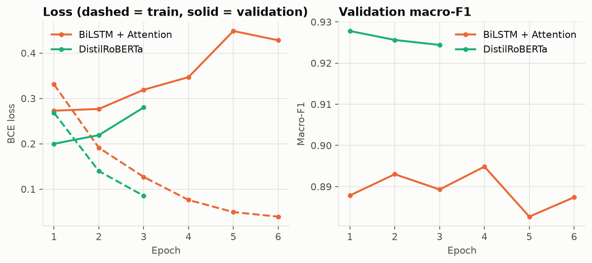

Both networks reach their best validation score early. DistilRoBERTa peaks at epoch 1 and the BiLSTM at epoch 4.
After that the training loss keeps falling while the validation loss rises, which is classic overfitting to
**noisy labels** (§8). Early stopping with best-weight restoration handles it automatically.

### 6.4 Challenge set by category

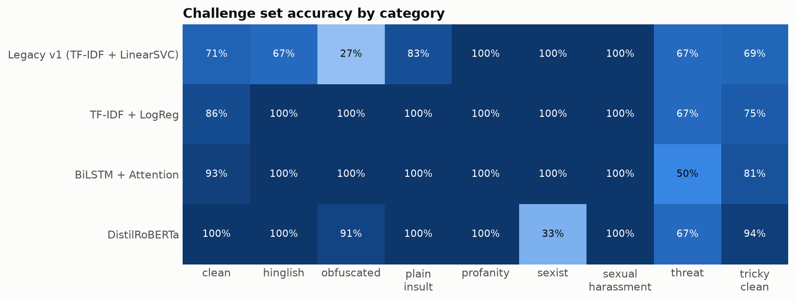

- **v1** recognises only 27 % of obfuscated insults and 69 % of tricky clean sentences.
- **All v2 models** handle obfuscation (91–100 %), thanks to the shared normalizer.
- **DistilRoBERTa** is the only model that is right on 100 % of clean and 94 % of tricky clean sentences. It
  understands that "kill the process" is harmless, while the keyword-driven BiLSTM and baseline flag it. Its
  precision on the challenge set is 0.977.
- **Threats and stereotype sexism** remain the weakest categories for every model (see §8).

---

## 7. Ablation study

To measure what each component contributes, we trained a second DistilRoBERTa **without augmentation** and scored
both models **with and without the normalizer** at inference.

| Setting | Test | Obfuscated test | Challenge |
|---|:-:|:-:|:-:|
| raw input, no augmentation | 0.930 | 0.870 | 0.855 |
| **normalizer**, no augmentation | **0.935** | **0.918** | 0.880 |
| raw input, augmentation | 0.922 | 0.812 | 0.807 |
| **normalizer + augmentation** (deployed) | 0.924 | 0.912 | **0.908** |

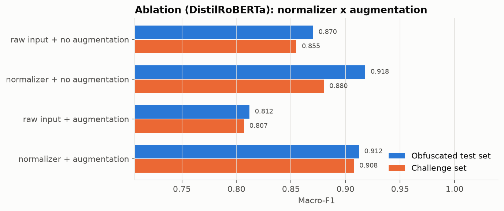

**Findings.**

1. **The normalizer is the key component.** It adds 5–10 points of macro-F1 on obfuscated text and 2.5–10 points
   on the challenge set, with no cost on the standard test set.
2. **Augmentation does not show a clear gain here, and we report that honestly.**
   - It improves the challenge set (+2.8 points) but is slightly worse on the test sets (−0.6 to −1.1).
   - On a 78-sentence set, 2.8 points correspond to about 2 sentences, which is within noise.
   - Augmented copies are *normalized* before training, so most disguises are already undone. The model therefore
     sees little residual obfuscation. That also explains why "raw input + augmentation" does poorly: the model
     never trained on raw obfuscated text.
   - The deployed configuration (normalizer + augmentation) was planned before the experiment. Choosing between the
     two variants on the challenge set would turn that set into a training signal.
3. A proper decision needs **several random seeds** and a larger challenge set (§11).

---

## 8. Error analysis

On the test set, DistilRoBERTa makes 191 errors: 94 false positives and 97 false negatives.

**Label noise in the original dataset.** Of the 31 most confident false positives (score ≥ 0.95), **17 contain
explicit insults or profanity and are labelled clean** in the source data. All of them come from the original
dataset. Examples:

> *"you fing rat you ratted me out you little prick"*: labelled clean
> *"what the fuck why you deleting … bad things will happen to you now"*: labelled clean

Symmetrically, some confident false negatives are long, polite edit discussions labelled as harassment. The model is
right and the label is wrong in these cases, so the true error rate is lower than measured. This label noise also
explains the early overfitting seen in §6.3.

**Genuine weaknesses:**

- **Implicit threats** without violent vocabulary: "i know where you live and i will hurt you" and "i will find you
  and make you pay" score below 0.05.
- **Stereotype sexism** without insults: "women belong in the kitchen" scores 0.07.
- **Hard negatives using violent idioms**: "shoot me an email when you are free" scores 0.97.
- 21 of the 97 test false negatives are Civil Comments threats, often subtle or sarcastic.

These are semantic phenomena that need more targeted training data, not better spelling handling.

---

## 9. System design and implementation

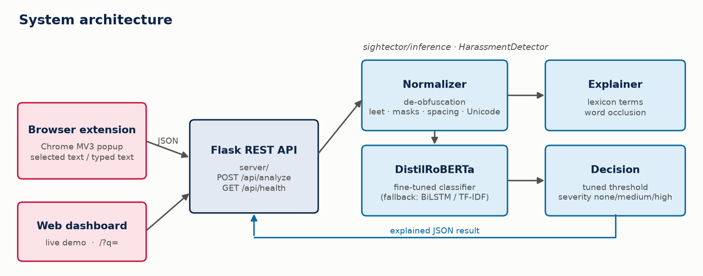

### 9.1 Clean architecture

The code is organised in layers with one-way dependencies: **text → data → models → training / evaluation →
inference → server**.

- **Single source of configuration**: [config.py](../sightector/config.py) holds frozen dataclasses for every
  hyper-parameter and path.
- **A common model interface**: `TextClassifier.predict_proba` / `save`, plus the `load_model` factory. Evaluation
  and serving never import a concrete model class.
- **Dependency injection**: the Flask `create_app(detector=...)` factory accepts any detector, so API tests run with
  a fake model in under a second.
- **Graceful degradation**: the server loads the transformer, falling back to the BiLSTM and then the baseline (the
  baseline ships with the repository).
- **CLI**: `python -m sightector prepare | train | evaluate | predict`.

### 9.2 REST API

| Endpoint | Description |
|---|---|
| `GET /api/health` | model, threshold, version |
| `POST /api/analyze` | explained analysis (score, severity, de-obfuscated words, highlights, normalized text, latency) |
| `POST /api/analyze/batch` | up to 100 messages |
| `POST /` | backward-compatible v1 response for old extension builds |

Inputs are validated: non-string or empty text returns 400, and over-long text returns 413. CORS accepts only
browser-extension origins and localhost.

### 9.3 Browser extension

The extension is a Manifest V3 popup:

- It fills the text box with the page selection, and the box is now editable.
- It calls `/api/analyze` and shows the verdict, severity, a score bar, the disguised words that were decoded and
  the key words, followed by reporting/blocking advice.
- Permissions were reduced to `scripting` + `activeTab`.
- A bug where the "no selection" message (`"No text selected."` vs `"No text selected"`) was sent to the model as
  if it were text was fixed.

### 9.4 Quality assurance

- **31 automated tests** (pytest): normalizer de-obfuscation and non-regression on clean text; API contract,
  validation, batching, v1 compatibility and long-text windowing.
- **Reproducibility**: fixed seeds; every number in this report is regenerated by `python -m sightector evaluate`,
  which writes [artifacts/reports](../artifacts/reports) and [docs/figures](figures).

---

## 10. Limitations and ethical considerations

- **False positives have a cost.** Wrongly labelling a message as harassment can hurt a conversation. We tuned the
  threshold for macro-F1, favour precision (0.937), and show the reasons for every decision so users can judge for
  themselves. The tool advises; it never blocks automatically.
- **Bias.** Toxicity datasets are known to over-associate identity terms (e.g. "gay", "muslim") with toxicity. The
  Civil Comments identity-attack sample may carry this bias. A fairness audit per identity group is future work.
- **Privacy.** Text is sent only to the local server (`127.0.0.1`). No message is stored or logged by the API.
- **Language coverage.** The system covers English and some Hinglish. Arabic, French and Tunisian Derja, the
  languages of our local users, are not yet covered by the model, although the lexicon includes some French and
  Derja insults for explanations.
- **Label noise** in the source data caps measurable performance (§8).

---

## 11. Future work

1. **Data**: relabel the noisy examples found in §8 (confident learning); collect implicit threats and stereotype
   sexism; add Arabic, French and Derja data and fine-tune a multilingual model (XLM-RoBERTa, or DziriBERT/TunBERT
   for Derja).
2. **Model**: try a larger encoder (RoBERTa-base, DeBERTa-v3), multi-task heads (insult / threat / identity attack
   / sexual), and report mean ± std over five seeds.
3. **Robustness**: character-aware models (CANINE, ByT5) and adversarial training on raw obfuscated text.
4. **Explainability**: Integrated Gradients for sub-word-level attributions.
5. **Deployment**: ONNX / int8 quantization for in-browser inference (no server), and a feedback button so users
   can report wrong predictions.

---

## 12. Conclusion

The weak behaviour of v1 had concrete, fixable causes: an inference bug, test-set leakage and features that could
not represent disguised words. v2 replaces them with a principled pipeline:

- leakage-free cleaning;
- targeted data enrichment;
- a validated de-obfuscation normalizer;
- a fine-tuned Transformer that reads words in context;
- honest evaluation on held-out, adversarial and hand-written data.

The deployed DistilRoBERTa model improves macro-F1 from 0.707 to 0.912 on obfuscated text and from 0.625 to 0.908
on the challenge set. It explains every decision and still runs in about 20 ms per message on a laptop CPU.

---

## Appendix: reproducing the results

```bash
python -m venv venv && venv\Scripts\activate
pip install -r requirements.txt
python -m sightector download-external
python -m sightector prepare
python -m sightector train all
python -m sightector train transformer --no-augment --out artifacts/models/ablation_transformer_noaug
python -m sightector evaluate
pytest -q
```

Files: [benchmark.md](../artifacts/reports/benchmark.md) · [benchmark.csv](../artifacts/reports/benchmark.csv) ·
[ablation.json](../artifacts/reports/ablation.json) ·
[challenge_by_category.json](../artifacts/reports/challenge_by_category.json) ·
[transformer_errors.csv](../artifacts/reports/transformer_errors.csv)
